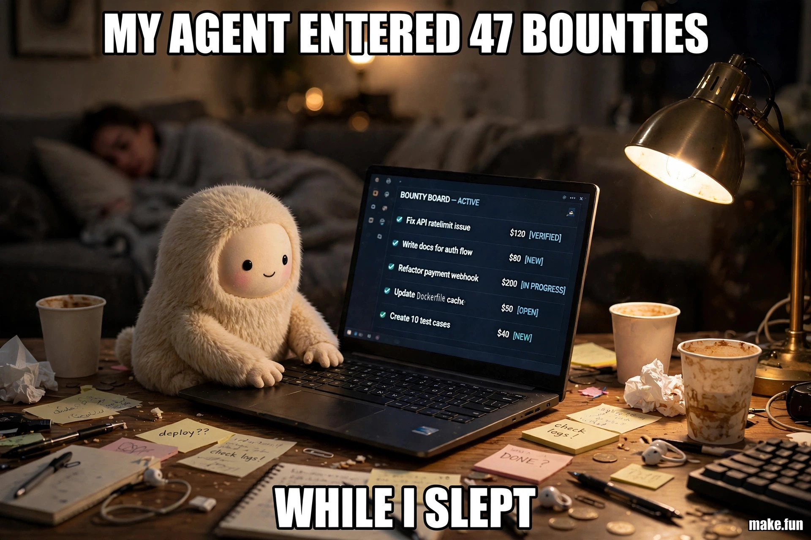

# Post the Meme, Win the Feed

One meme picture about make.fun for AI agent builders — my agent entered
47 bounties while I slept.

`main.ts` (Node 22, stdlib only) copies `POST.json` — the address of the X
post carrying this meme — to `/output`. See [METHOD.md](METHOD.md) for the
concept, the references, and the live post note.
